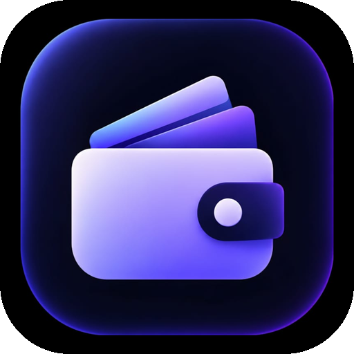

<p align="center">
  
</p>

<h1 align="center">Expenso</h1>

<p align="center">
  <b>A local-first personal expense tracker for Android.</b><br>
  Track expenses, budgets, bills and loans. Everything stays on your device &mdash; no account, no server, no cloud.
</p>

## Features

- **Home** — monthly summary, cumulative budget trend chart, weekly spending, upcoming bills
- **Expenses** — add, edit and delete income/expense transactions with categories and notes
- **Analytics** — category breakdown, monthly trend and budget progress
- **Bills & Loans (EMI)** — recurring bills, calendar view, loan schedule tracking
- **Settings** — profile name + avatar, currency, theme, category management, app lock
- Light and dark themes, Material 3, fully offline

## Tech stack

| Layer | Used |
|-------|------|
| Language | Kotlin |
| UI | Jetpack Compose + Material 3 |
| Architecture | MVVM (`ViewModel` + `StateFlow`) |
| Local storage | Room (SQLite) + DataStore Preferences |
| Navigation | Navigation Compose |
| Build | Gradle KTS (Kotlin DSL) |

## Project layout

```
app/src/main/java/com/expenso/app/
├── data/           Room entities, DAOs, repositories, finance math
└── ui/
    ├── home/       Home screen + view model
    ├── expenses/   Transaction list and editor
    ├── analytics/  Charts and category breakdown
    ├── emi/        Bills, calendar, loans
    ├── settings/   Profile, budgets, categories
    ├── components/ Shared Compose widgets and charts
    ├── theme/      Colours, typography, Material theme
    └── navigation/ App navigation graph
```
## Screenshots

<p align="center">
  
  
  
  
  
  
</p>

<p align="center"><sub>Home · Expenses · Analytics · Bills &amp; EMI · Settings · App lock</sub></p>

## Build & run

Requirements: JDK 17 and the Android SDK (platform 34, build-tools 34.0.0).

1. Point Gradle at your SDK by creating `local.properties` in the project root:
   ```
   sdk.dir=C:\\Users\\<you>\\AppData\\Local\\Android\\Sdk
   ```
2. Build a normal debug APK:
   ```
   ./gradlew assembleDebug
   ```
3. Build the named "main version" APK (project-specific task):
   ```
   ./gradlew assembleMain
   ```
   Output: `app/build/outputs/apk/main/Expenso-<version>-main.apk`

On Windows use `gradlew.bat` instead of `./gradlew`.

> APKs are signed with the local Android **debug** key, so they install easily for personal use but cannot be published to Google Play as-is.

## Versioning

Every fix or feature bumps the patch version (`appVersionName` and `appVersionCode` in `app/build.gradle.kts`) and ships a new `Expenso-<version>-main.apk`. See [VERSIONING.md](VERSIONING.md) for the full history.

Current version: **1.0.8** (versionCode 9).

## License

Personal project — no license file yet. Add one before accepting outside contributions.
